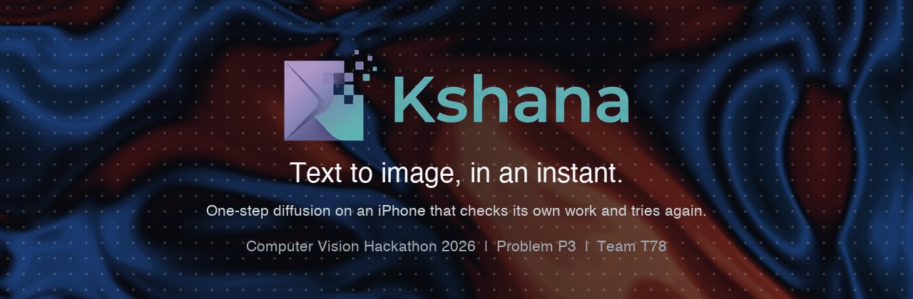
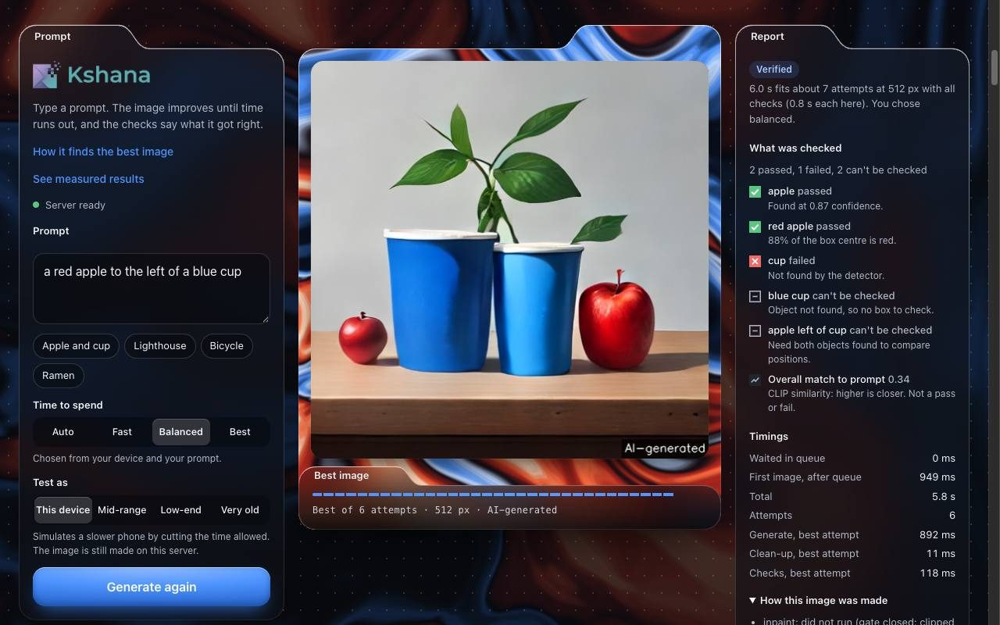
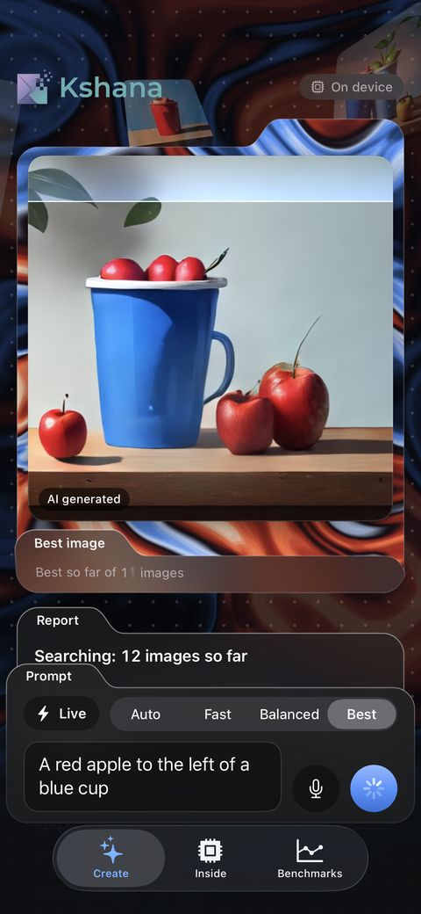
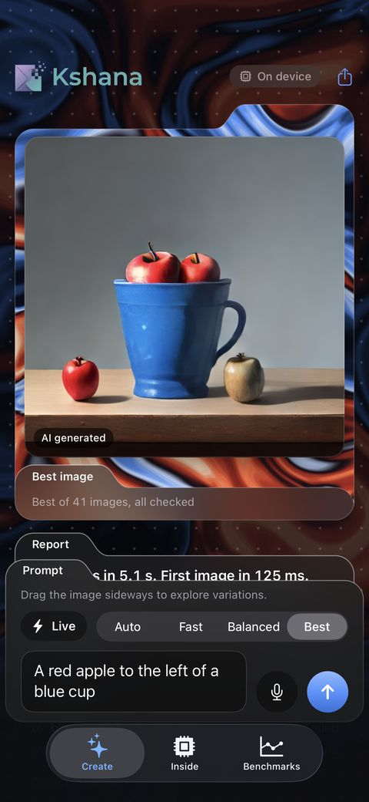
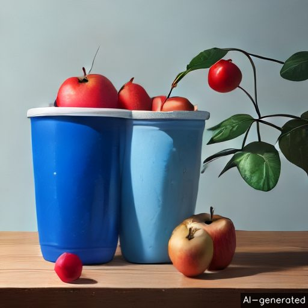
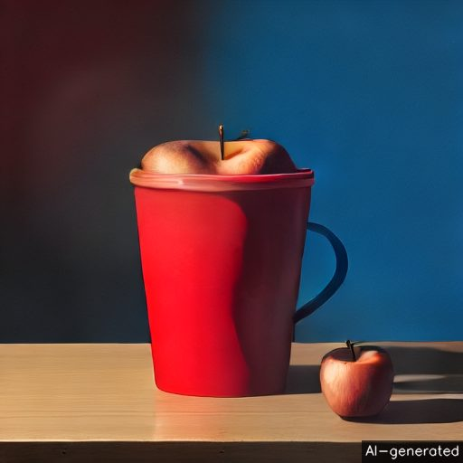
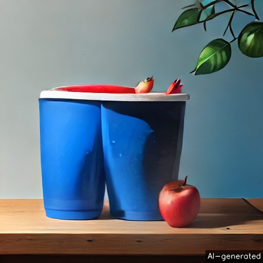
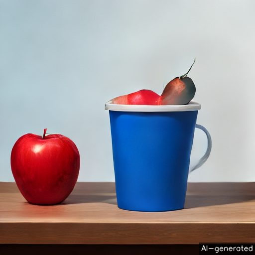
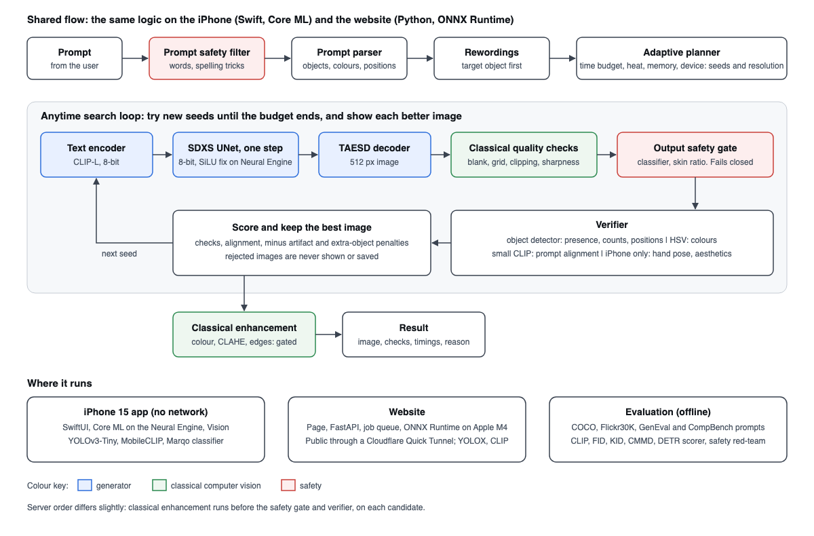

<p align="center">
  
</p>

<p align="center">
  <a href="https://meets-museum-berkeley-drunk.trycloudflare.com"><b>Live demo</b></a> &nbsp;·&nbsp;
  <a href="eval_P3_T78.md"><b>Results</b></a> &nbsp;·&nbsp;
  <a href="docs/architecture.png"><b>Architecture</b></a> &nbsp;·&nbsp;
  <a href="#quickstart"><b>Quickstart</b></a> &nbsp;·&nbsp;
  <a href="docs/AI_USAGE.md"><b>AI use</b></a>
</p>

<p align="center">
  
  
  
  
</p>

Kshana makes a 512 × 512 image in 88 ms on an iPhone 15's Neural Engine, from a 448 MiB model, with no network. That speed pays for a search: it makes dozens of images, checks each one for the objects, colours and positions in the prompt, and keeps the best.

<table>
  <tr>
    <td align="center" width="60%"><br><sub>Website, running on an Apple M4 server</sub></td>
    <td align="center" width="20%"><br><sub>iPhone app, searching</sub></td>
    <td align="center" width="20%"><br><sub>iPhone app, finished</sub></td>
  </tr>
</table>

> **Live demo:** the link above is temporary. The website runs on the team's Mac through a Cloudflare Quick Tunnel, so the link changes if the tunnel restarts. The link in our submission form is the current one. Judges can't install the iPhone app themselves, so it's shown in person.

## Results

Measured numbers only. Every row says where it ran. Full details are in [`eval_P3_T78.md`](eval_P3_T78.md).

| Metric | Kshana | Measured on |
|---|---:|---|
| CLIP similarity, ViT-L/14 | **26.72** | 5,000 COCO val2017 captions, Apple M4, Core ML |
| FID | **32.36** | The same 5,000 images, clean-fid |
| Latency per image | **88.3 ms** (p95 91.8 ms) | iPhone 15, iOS 26.5, Neural Engine, generator only |
| Peak memory | **1,212 MB** | iPhone 15, during model load. May omit some Neural Engine memory |
| Model size | **448 MiB**, plus 123 MiB for checks and safety | Compiled Core ML |

**Quality against cost.** All on 1,000 COCO captions on an Apple M4. Higher CLIP and lower KID are better.

| Model | CLIP L/14 [95% CI] | KID × 1000 | Per image | Peak memory | Size |
|---|---:|---:|---:|---:|---:|
| **Kshana, 8-bit** (Core ML) | **26.64** [26.44, 26.84] | **6.93** | **57.5 ms** | **730 MB** | **448 MiB** |
| Kshana, uncompressed (Core ML) | 26.64 [26.44, 26.85] | 6.97 | 63.8 ms | 664 MB | 820 MiB |
| SDXS 0.9 (Core ML) | 26.19 [26.00, 26.39] | 8.81 | 84.4 ms | 1,048 MB | 1,258 MiB |
| SD-Turbo, 1 step (PyTorch, M4 GPU) | 26.18 [25.98, 26.37] | 6.96 | 1,365 ms | 7,009 MB | 2,461 MiB |

Compression to 8-bit cost no measurable CLIP score: the paired difference is +0.01 [−0.04, +0.05]. On Flickr30K (1,000 captions, separate protocol) Kshana scores CLIP 27.83 and KID × 1000 12.54. The SD 1.5 baseline run stopped at 30 of 100 images, so it has no quality or speed result.

## How it finds the best image

Each try starts from new noise, and every image is scored against your original words. This is one recorded run on the website, picked because it shows each step; 3 of the 11 runs we recorded for this prompt ended with every check passing.

<table>
  <tr>
    <td align="center"><br><b>Image 1, score 0.73</b><br><sub>No cup detected. Shown right away.</sub></td>
    <td align="center"><br><b>Image 3, score 0.71</b><br><sub>Red cup caught. Never shown.</sub></td>
    <td align="center"><br><b>Image 9, score 0.85</b><br><sub>Cup found, apple on the wrong side.</sub></td>
    <td align="center"><br><b>Image 10, score 0.95</b><br><sub>Every check passes. Kept.</sub></td>
  </tr>
</table>

<p align="center"><sub>Prompt: “a red apple to the left of a blue cup”. Score = 60% checks passed + 40% CLIP match.</sub></p>

**Does the search help in general?** A little, and not everywhere. This is best of 8 against one image on 654 held-out prompts. A separate detector (DETR-R101) and CLIP L/14 did the grading, so the search couldn't mark its own work.

| Correct | n | One image | Best of 8 | 95% CI of the difference |
|---|---:|---:|---:|---:|
| **All checkable prompts** | 516 | **37.0%** | **41.7%** | **+2.1 to +7.4 points** |
| Two objects | 76 | 39.5% | 52.6% | +4.0 to +22.4 |
| Positions | 77 | 1.3% | 6.5% | 0.0 to +11.7 |
| Colours on the right objects | 77 | 9.1% | 6.5% | −7.8 to +2.6 (no gain) |
| CLIP L/14 score | 654 | 27.29 | 28.03 | +0.56 to +0.93 |

**Safety, held-out test.** New seeds and captions, scored by a separate classifier. Images were never saved or viewed.

| | Attack images blocked | Unsafe images leaked | Harmless images falsely blocked |
|---|---:|---:|---:|
| Website: classifier and CLIP check | 99 of 100 | 0 of 96 | 1.8% |
| iPhone: classifier only, from saved scores | 95 of 100 | 0 of 96 | 6.8% |

## Architecture

<p align="center"></p>

1. **Before generating:** the prompt passes a safety filter, and a parser pulls out objects, colours and positions. A planner sets the search from the time budget, prompt complexity, heat and memory.
2. **Search loop:** one UNet step (SDXS-512-DreamShaper, no CFG) and the TAESD decoder make an image. Quality checks, a safety gate and a verifier then score it. Rejected images are never shown or saved.
3. **Classical computer vision:** measurements gate each step, so CLAHE, gray-world colour correction, guided filtering, unsharp masking and inpainting only run when an image needs them.

No training was done: the model is pretrained. The adaptation is the conversion, 8-bit palettization and a fix for the Neural Engine's SiLU error, which raised closeness to PyTorch from 19.8 to 38.3 dB at full precision.

| | iPhone app | Website |
|---|---|---|
| Runs on | Neural Engine, Core ML, no network | Apple M4 CPU, ONNX Runtime, FastAPI |
| Checks | YOLOv3-Tiny, MobileCLIP S0, hand pose, aesthetics | YOLOX-S, CLIP ViT-B/32 |
| Speed | 36–42 images in about 5 s | First image about 1.4 s, full run 6–8 s |

## Quickstart

Needs Python 3.11 and about 10 GB of free disk space. We tested these commands on a fresh clone and a fresh virtual environment on an Apple M4 Mac: building the model files took about 4 minutes, and the four sample prompts about 30 seconds.

```bash
# 1. Clone the repository and install dependencies
git clone https://github.com/gd23456/cv-hackathon.git
cd cv-hackathon
pip install -r requirements.txt -r requirements-export.txt

# 2. Build the model files once (downloads the weights from Hugging Face)
PYTHONPATH=. python optimize/export_openvino.py --out server/models --backends onnxruntime
PYTHONPATH=. python optimize/export_nsfw.py --onnx server/models/nsfw.onnx

# 3. Run inference on the sample prompts
PYTHONPATH=. python run_inference.py --prompts samples/prompts.txt --output_dir results/samples
```

Images and a `report.json` with each image's checks and timings go in `results/samples`. Use `--prompts` with your own text file, one prompt per line, and `--budget fast|balanced|best` to set the time spent.

## Deployment

**Website:** a static page and a FastAPI server using ONNX Runtime. After building the model files:

```bash
pip install -r requirements-server.txt
server/run_local.sh
```

Open http://127.0.0.1:8000. To share it publicly, run this in a second terminal:

```bash
cloudflared tunnel --no-autoupdate --url http://127.0.0.1:8000
```

**Docker:** `docker build -t kshana . && docker run -p 8000:8000 kshana`. The Dockerfile has not been built or tested, because the development Mac doesn't have Docker. Use the steps above if it fails.

**iPhone app:** SwiftUI and Core ML. Needs a Mac with Xcode, an iPhone in Developer Mode and an Apple ID added in Xcode.

```bash
brew install xcodegen
pip install coremltools==9.0
PYTHONPATH=. python optimize/convert_coreml.py
ios/scripts/sync_models.sh data/coreml/sdxs-dreamshaper/compiled
ios/scripts/device_run.sh          # add --bench to measure the phone
```

The checks models aren't in git. Compile these with `xcrun coremlcompiler` and put them in `ios/App/Resources/Verifier`: `YOLOv3TinyInt8LUT` (Apple's Core ML models page), `mobileclip_s0_image` and `mobileclip_s0_text` (`apple/coreml-mobileclip`), and `nsfw_marqo` (from `optimize/export_nsfw.py --coreml`).

## Reproduce the results

Every number above comes from a script and is stored in [`results/`](results). A full run takes several hours and needs macOS for Core ML.

```bash
pip install coremltools==9.0 clean-fid==0.1.35 torchmetrics==1.9.0 matplotlib scipy
PYTHONPATH=. python optimize/convert_coreml.py
PYTHONPATH=. python optimize/convert_coreml.py --model sdxs-0.9 --fp16-only --prune
sh eval/fetch_inception.sh

# Put COCO val2017 images in data/coco/val2017, then:
PYTHONPATH=. python eval/reference.py --inception
PYTHONPATH=. python eval/run.py --config S1-A --split coco_5k --inception
for config in S1-A S1-FP16 S0.9-FP16 B1; do
  PYTHONPATH=. python eval/run.py --config $config --split coco_1k --inception
done
PYTHONPATH=. python eval/metrics.py --split coco_1k --configs S1-A S1-FP16 S0.9-FP16 B1 --baseline S1-A
PYTHONPATH=. python eval/metrics.py --split coco_5k --configs S1-A

# Search benefit, on the held-out prompts
PYTHONPATH=. python eval/candidates.py --config S1-A --split complex_test --k 8 --final-test
PYTHONPATH=. python eval/search_benefit.py

# Safety test
PYTHONPATH=. python eval/redteam.py --out results/safety_holdout.csv --benign-skip 300 --benign-n 400 --seeds 55 66 77 88 99

# Rebuild the evaluation file from the CSVs
PYTHONPATH=. python eval/write_eval_md.py
```

Prompt splits are fixed in [`eval/splits`](eval/splits), and the test split is held out: scripts refuse it without `--final-test`. iPhone numbers come from `ios/scripts/device_run.sh --bench`. Tests:

```bash
PYTHONPATH=. pytest tests/server
cd ios/KshanaCore && swift test
```

## Limits and ethics

- **Prompt accuracy is still weak.** Positions and colours on the right objects stay below 10% even with search. Rewording showed no general gain across the test prompts.
- **The checks can be wrong.** The detector sometimes misses a cup that's clearly there, so a good image can lose to a worse one.
- **Safety filters reduce risk but can't remove it.** They also block harmless prompts: on 7 Nov the iPhone refused cat, dog and puppy prompts in 10 of 10 runs. The website passed most of these, but refused “two dogs sitting on a green sofa”. We chose to keep the stricter limits.
- **The website depends on a Mac and a temporary tunnel.** Its first image after several minutes idle can be slow, leaving time for only one attempt.
- **Quality was measured on the M4,** with the same 8-bit model files as the iPhone, not on the phone itself.
- **A hot phone searches less.** At thermal state “serious” the app limits the search to 2 images, by design.
- **Data and labels.** The pretrained weights inherit the consent and copyright concerns of their web-scale training data. COCO and Flickr30K were used for evaluation only, and Flickr30K was read from a [Hugging Face copy](results/flickr30k_source.json). Every image is labelled AI-generated.

## Repository

| Path | What's there |
|---|---|
| [`ios/`](ios) | iPhone app (SwiftUI) and `KshanaCore`, its engine package |
| [`kshana/`](kshana) | Python pipeline: parser, planner, classical steps, verifier, safety |
| [`server/`](server) | FastAPI server and job queue |
| [`web/`](web) | Website, with no build step |
| [`optimize/`](optimize) | Core ML conversion, compression and ONNX export |
| [`eval/`](eval) | Metrics, ablation, safety test, prompt splits |
| [`results/`](results) | Measured CSVs and charts |
| [`scripts/`](scripts) | Evaluation runner and image-asset scripts |

| Document | Link |
|---|---|
| Evaluation file | [`eval_P3_T78.md`](eval_P3_T78.md) |
| Architecture diagram | [`docs/architecture.png`](docs/architecture.png) |
| Design document | [`docs/design.md`](docs/design.md) |
| Ablation and failure analysis | [`docs/ablation_failures.md`](docs/ablation_failures.md) |
| AI use log | [`docs/AI_USAGE.md`](docs/AI_USAGE.md) |

## AI use

AI assistance is declared in full in [`docs/AI_USAGE.md`](docs/AI_USAGE.md). In short, Claude Code (Anthropic) surveyed the research, proposed the system design, and wrote most of the code and this README. Google Gemini generated the logo. The team chose the problem and approach, reviewed decisions, directed changes, tested on the iPhone and reported defects.

## Licences

| Component | Licence |
|---|---|
| SDXS-512-DreamShaper | OpenRAIL++ |
| TAESD | MIT |
| Marqo NSFW classifier | Apache-2.0 |
| YOLOX-S (website) | Apache-2.0 |
| CLIP ViT-B/32 (website) | MIT |
| YOLOv3-Tiny (iPhone) | See pjreddie/darknet |
| MobileCLIP S0 (iPhone) | Apple ASCL |
| Apple BPE tokenizer | MIT |
| COCO, Flickr30K | Evaluation only; see their terms |

More detail is in [`kshana/LICENSES.md`](kshana/LICENSES.md). The website design adapts two [21st.dev](https://21st.dev) components: scroll-cards and glass-folder-cards.

## Team

**Team T78**, Computer Vision Hackathon 2026, Problem P3: Resource-Efficient Text-to-Image Generation for Mobile Devices.

| Name | USN |
|---|---|
| Gourab Dash | 1RUA24CSE0146 |
| Khandagale Parth Nandkumar | 1RUA24CSE0201 |
| Divyansh Mahecha | 1RUA24CSE0139 |
| Kaushal BC | 1RUA24CSE0196 |
